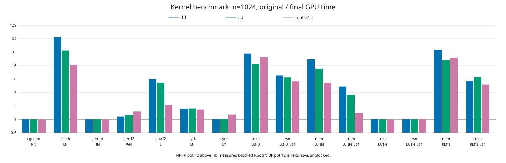
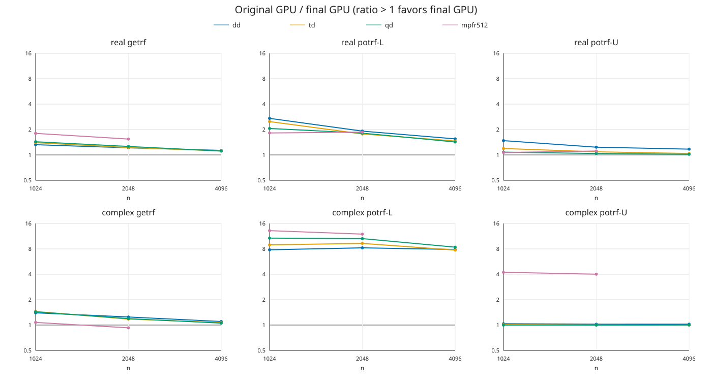
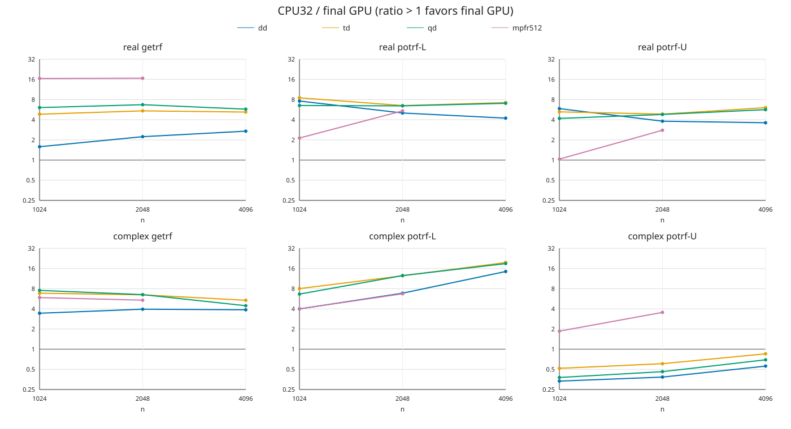
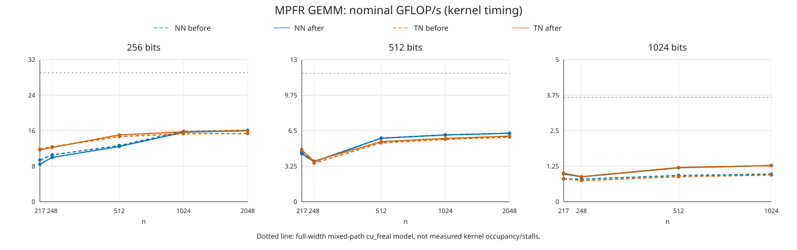

# GPU kernel optimization — factorization goal 10

November 2026, Threadripper 3970X / A100 80GB PCIe, CUDA 13.1, GCC 15.2.
Historical items1–5: original implementation `1577e80c5`; final implementation `659967a52`.

**November7 item4b supplement:** [ordered Upper Cholesky](upper/README.md),
with new paired timings, both roofline models, stream-overlap profiles and exact
validation. Native complex Upper meets the1.5× Lower target; MPFR256/512 retains
measured shortfalls. Control variability and the full-complex sanitizer exception
are explicit. The tables below remain the original items1–5 evidence.
Reference bodies, CPU kernels, fast modes and default dispatch gates were not changed.

## Results



Representative **kernel** times (seconds). Percentages use the same current
[roofline model](../roofline/README.md) on both sides, including the revised
[MPFR full-width arithmetic model](../roofline/mpfr/README.md).
They are model utilization, not measured occupancy.

| Type | Kernel | n | Original s | Final s | Roofline original → final |
|---|---|---:|---:|---:|---:|
| dd | TRSM LLNU | 2048 | 1.96020 | .0472169 | 1.4 → 56.7% |
| dd | TRSM LLNU p64 | 2048 | .000833728 | .000124352 | 3.1 → 20.9% |
| dd | SYRK LN | 2048 | .0530147 | .0303756 | 50.5 → 88.2% |
| dd | HERK LN | 2048 | 6.05165 | .109083 | 1.8 → 98.2% |
| dd | getrf2 P64 | 2048 | .00372019 | .00325018 | .7 → .8% |
| dd | potrf2 L | 2048 | .545914 | .0461148 | 1.6 → 19.4% |
| qd | TRSM LLNU | 2048 | 2.49708 | .262071 | 7.5 → 71.2% |
| qd | TRSM LLNU p64 | 2048 | .00237360 | .000417440 | 7.7 → 43.7% |
| qd | SYRK LN | 2048 | .352839 | .200717 | 52.9 → 93.0% |
| qd | HERK LN | 2048 | 14.1776 | .770392 | 5.3 → 97.0% |
| qd | getrf2 P64 | 2048 | .00554598 | .00443392 | 3.3 → 4.1% |
| qd | potrf2 L | 2048 | 1.58406 | .183340 | 3.9 → 34.0% |
| mpfr512 | TRSM LLNU | 1024 | 3.75770 | .153933 | 2.4 → 59.4% |
| mpfr512 | TRSM LLNU p64 | 1024 | .0138747 | .00196635 | 2.6 → 18.3% |
| mpfr512 | SYRK LN | 1024 | .475593 | .286281 | 19.2 → 32.0% |
| mpfr512 | HERK LN | 1024 | 43.8127 | 2.62793 | .8 → 13.9% |
| mpfr512 | getrf2 P64 | 1024 | .0221023 | .0146599 | 1.6 → 2.4% |
| mpfr512 | potrf2 L | 1024 | .924975 | .439644 | 3.3 → 6.9% |

**Do not compare the potrf2 rows as identical algorithms:** BF measures recursive,
unblocked potrf2; MPFR above nb measures blocked Rpotrf through its public entry.
The full 120-point before/after matrix and model tables are in
[kernel-comparison.csv](kernel-comparison.csv), [before](roofline-before/roofline.csv)
and [after](roofline-after/roofline.csv).

### Whole factor entry, including packing/transfers




Selected n=2048 values; CPU is the optimized CPU library with 32 threads.
All 66 cases, including td, Upper and BF n=4096, are in [factors.csv](factors.csv).

| Type | Routine | Original GPU s | Final GPU s | CPU32 s | GPU speedup |
|---|---|---:|---:|---:|---:|
| dd | Rgetrf | .228907 | .188598 | .421505 | 1.21× |
| dd | Rpotrf L | .190582 | .099584 | .502280 | 1.91× |
| dd | Cpotrf L | 1.64109 | .199294 | 1.36669 | 8.23× |
| qd | Rgetrf | .484134 | .384369 | 2.57996 | 1.26× |
| qd | Rpotrf L | .492213 | .271609 | 1.75137 | 1.81× |
| qd | Cpotrf L | 7.01432 | .662597 | 8.31977 | 10.59× |
| mpfr512 | Rgetrf | 2.64163 | 1.71391 | 28.5868 | 1.54× |
| mpfr512 | Rpotrf L | 2.94894 | 1.58446 | 8.60803 | 1.86× |
| mpfr512 | Cpotrf L | 75.7610 | 6.33348 | 42.5386 | 11.96× |

These are cumulative improvements, not solely the right-looking change.
The isolated Lower change at n=1024, median of three interleaved rounds:

| Type | Real Lower speedup | Complex Lower speedup |
|---|---:|---:|
| dd | 1.299× | 1.413× |
| qd | 1.308× | 1.846× |
| mpfr256 | 1.335× | 1.790× |
| mpfr512 | 1.349× | 1.796× |
| mpfr1024 | 1.383× | 1.272× |

See [lower-isolated-1024.csv](lower-isolated-1024.csv) and the independently
rerun [precision-factors.csv](precision-factors.csv). The latter also includes
LU/Upper controls and the subsequent GEMM change. At 1024 bits the complex
Upper control varied by −3.8%; do not claim uniform timing invariance.

**Not every case improved.** MPFR512 complex LU n=2048 has a confirmed cumulative
regression: repeated medians 23.695 s original, 25.517 s immediately before item5,
25.385 s final (about 7.1% slower than original). It predates the real GEMM change;
[all three rounds](complex-lu-control.csv) are retained. BF complex Upper can
remain slower than CPU: qd n=2048 is 6.810 s GPU versus 3.144 s CPU.
No gate retuning was made to hide these cases.

### MPFR GEMM



At n=1024, 1024-bit NN improves 2.2101 → 1.6881 s (1.309×), TN
2.2851 → 1.6870 s (1.355×). NN reaches about 35% of the revised cu_freal
mixed-path model. All four transpose forms and odd sizes are in
[mpfr-gemm.csv](mpfr-gemm.csv).

Shared operand loads alone did **not** improve 256/512-bit NoTrans: their
original public kernel is retained. Transpose improvements there are small.
Resident fixed-real updates additionally avoid repeated alpha*B work;
512-bit LU n=1024 improves 1.123× and Upper Cholesky 1.049× for item5 alone.
Corrected 256/1024-bit measurements are in `precision-factors.csv`.
Untuned precisions, runtime arithmetic, complex GEMM and Winograd remain conservative.

## Profiling and implementation

- **TRSM:** cooperative independent row/column updates and ordered blocked solves;
  reciprocal multiplication, zero skips and per-output term order retained.
- **SYRK/HERK:** shared alpha preprocessing with original-value skip masks,
  triangular tiles and real Hermitian diagonals. BF approaches the modeled
  bound; MPFR HERK remains far below it.
- **Panels:** fused scalar LU leaves and tiny recursive Cholesky leaves;
  element-parallel trailing work. Large/runtime footprints remain conservative.
  dd n=1024 panel profiling reduced LU launches 2536→2024 and Cholesky
  launches 12668→3452; Cholesky copies 4096→1024.
- **Lower Cholesky:** the initial narrow left-looking update diagnosis was
  supported by profiles. Ordered right-looking trailing tiles retain each
  destination's eventual SYRK/HERK-versus-GEMM rules. Failed factorizations
  publish only completed columns and the failing diagonal block; POSV RHS
  remains untouched. Upper's arithmetic schedule is unchanged.
  Isolated n=1024 profiles reduce dd launches 3452→3180 and MPFR real
  6416→6252 without changing copy counts. Warm numeric spans improve
  .02244→.01641 s dd, .62857→.44208 s MPFR real, 2.44203→1.27842 s complex.
  [Profile counts](lower-profiles.csv) cover four calls, including warmup.
- **MPFR GEMM:** shared tiles retain increasing-k operations and distinguish
  the legacy public arithmetic from signed-zero-preserving resident arithmetic.
  At 1024 bits, a measured register budget matters more than sharing alone.
  Production NN resources change from 234 registers/544 stack bytes to
  128/1328, with 20736 shared bytes. An overly broad launch bound regressed
  512-bit transpose and was rejected. [Profiles](gemm-profiles.csv) contain
  actual before/after resources and four-call kernel totals.

`ncu` hardware counters were unavailable (`ERR_NVGPUCTRPERM`). These conclusions
use nsys timelines, controlled alternatives and static resource reports;
there are **no measured occupancy or stall percentages** here. CUDA stack-limit
policy and external MPC-CUDA sources were not changed.

Remaining shortfalls include dd p64 TRSM (~21%, below the 30% target), panel
launch/serial costs, MPFR HERK, and 256/512-bit public NoTrans GEMM. The revised
MPFR arithmetic-path model is a more relevant comparison than the historical
same-sign, double-derived madd peak, but is not a promise of attainable kernel speed.

## Correctness and build evidence

| Item / commit | Checks actually run |
|---|---|
| TRSM `861b1038c` | BF12 all-form / 36 consumer suites; MPFR4 all-form / 40 consumers; 63 exact dump pairs; required real/BF memchecks; both builds |
| SYRK/HERK `ba73551e8` | BF12/36, MPFR4/40, 33 exact dump pairs, required memchecks, both builds |
| Panels `767e48eec` | BF36 / MPFR40, BF12 / MPFR4 n=1000 suites, 48 small and 8 comparable large dump pairs, BF and MPFR-real memchecks, both builds |
| Lower `6067ce60d` | BF36 consumers plus final POSV6 / large-factor12; MPFR24 factor runs over six precisions, 40 consumers / BLAS4 / large-factor4; failed-block/signed-zero/padding cases; BF and real512/200/2048 memchecks; both builds |
| GEMM `659967a52` | Expanded all-precision host/device suite, final changed-precision tests, runtime512 and Winograd controls; MPFR40 / BF48 suites; real512 n=1000; GEMM512/1024 and factor512/200/2048 memchecks; both builds |

Factor tests preserve A, info, ipiv, padding and zero signs, including Lower/Upper,
near-singularity and failures at 1, nb−1, nb, nb+1, nb+2, 2nb, 2nb+1 and last.
MPFR factor coverage includes 256/512/768/1024/2048 and runtime200, real/complex.
No factor zero-sign differences were accepted. All 37 discovered MPLAPACK archives
in the final autotools/CMake trees passed uniqueness checks; non-generated dynamic
exports did not change.

The supplemental [GEMM checker](validation/gemm-boundaries.cpp) covers N/T/C,
all scalar variants, untouched-output zero-dimension returns, padded strides,
square 7/63/64/65 and rectangular
200×17×9 / 1000×17×7 at changed precisions. It compares **10,758,501 elements**
per host/before/after run against a separately named, included reference body,
not a shadowing GPU dispatcher. All three runs agree: zero ordinary mismatches,
86 identical **pre-existing public fixed-GEMM zero-sign exceptions**. Those
exceptions are outside this optimization's scope; resident factor arithmetic
has no such waiver. [Results](validation/results.txt).

**UNVERIFIED:** full MPFR complex compute-sanitizer memcheck, solely under the
maintainer-approved external MPC-CUDA defect exemption. Filtered right-update
checks are not a substitute. BF and MPFR-real sanitizer checks remain mandatory
and passed. No external source/patch, stack-policy or suppression workaround was added.

## Measurement and reproduction

- Kernel timing: device-resident BF CUDA events / MPFR CUPTI kernel timing,
  not end-to-end factor time. Factor timing uses the direct public entry and
  rejects a false return; CPU uses the separate optimized CPU library.
- One same-process warmup, best of three measured calls. Explicitly disable
  `Rkernel_bench`'s long-run early stop with `--long 999999`; `--reps 3` alone
  is insufficient for slow cases. Three historical one-repeat HERK rows were
  replaced using original code. Other original 117 kernel rows already had three runs.
- The 66-point original/final factor matrix uses immutable corrected drivers
  and frozen original/final libraries, with interleaved stage order. Precision
  and selected isolated/control tables use three interleaved rounds of best3.
- GPU-side host work uses one CPU thread; CPU reference uses 32 threads,
  `OMP_PLACES=cores OMP_PROC_BIND=spread`. MPFR precision is set for workers too.
  No compilation or other GPU workload ran during accepted timings; the final
  matrix has 720 empty before/after process receipts. Raw logs, exit receipts,
  rejected pilots and binary snapshots remain under `bench_local/results/gpu-opt/`.
- Benchmark fixes: `418b4915a` made factor-only `--entry` real and added warmup;
  `69420059e` corrected a hardcoded MPFR512 setter. Old factor labels256/1024
  were excluded and rerun with the corrected driver (108 interleaved calls).
  Kernel sweeps and numerical precision tests were not affected by that driver bug.
- An early supplemental check used the wrong threshold variable and then a
  shadowable oracle; those runs were rejected. The published checker names
  its reference independently. Normal CMake GEMM tests already link CPU oracles.

Examples after building the corresponding targets (set installed dependency
library paths as needed):

```sh
# Kernel matrix: repeat for dd/qd/mpfr, forms and sizes in kernels-after.csv.
OMP_NUM_THREADS=1 MPFRXX_DEFAULT_PRECISION_BITS=512 CUDA_MODULE_LOADING=EAGER \
  benchmark/Rkernel_bench.mpfr_cuda_kernel trsm LLNU 512,1024 \
  --warmup 1 --reps 3 --long 999999

# Factor example. MPFR precision now honors the environment; default remains512.
OMP_NUM_THREADS=1 MPFRXX_DEFAULT_PRECISION_BITS=1024 \
MPLAPACK_MPFR_LAPACK_CUDA=1 MPLAPACK_MPFR_LAPACK_CUDA_MIN=0 \
  benchmark/Rfactor.mpfr_cuda_total --entry --potrf --n 1024 --warmup 1 --repeat 3
# Add --complex / --upper; omit --potrf for LU.
OMP_NUM_THREADS=32 OMP_PLACES=cores OMP_PROC_BIND=spread \
MPFRXX_DEFAULT_PRECISION_BITS=512 \
  benchmark/Rfactor.mpfr_opt --potrf --n 2048 --warmup 1 --repeat 3

# From this directory; plotting has no third-party Python dependencies.
python3 plot.py
python3 validation/run.py --cmake-dir /tmp/factor01-cmake --output /tmp/goal10-gemm-check
# Optional: --before-libs PATH to a frozen pre-item5 library directory.
```

Use `benchmark/roofline.py PEAKS KERNELS EMPTY_SWEEP OUTPUT_DIR` to regenerate
the model tables. The unrelated independent MPFR model update is `3e2ae9b67`;
its work is not attributed to these implementation commits.
See [provenance.json](provenance.json) for revisions and frozen library hashes.
