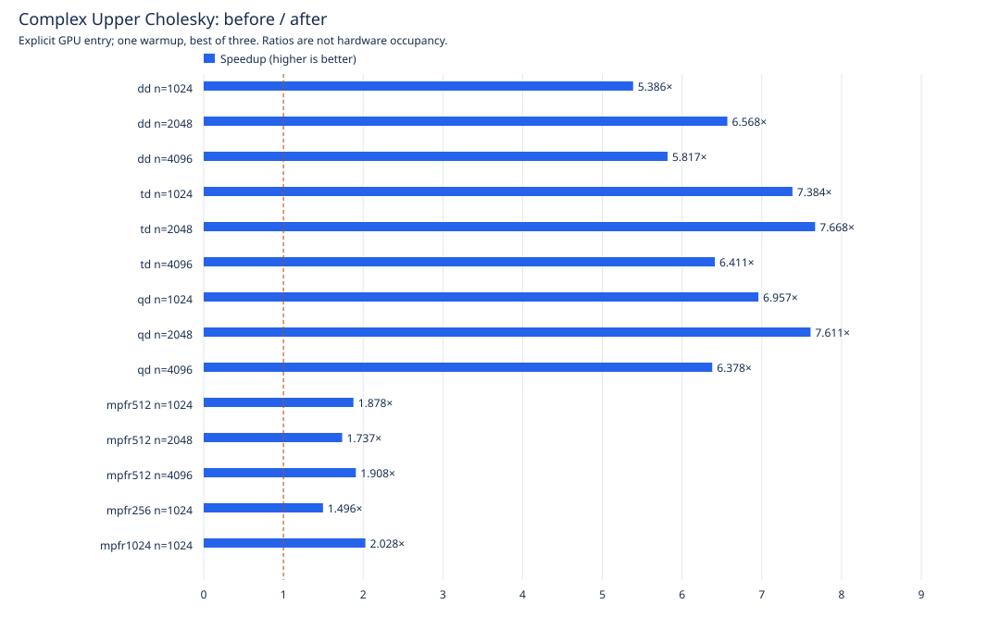
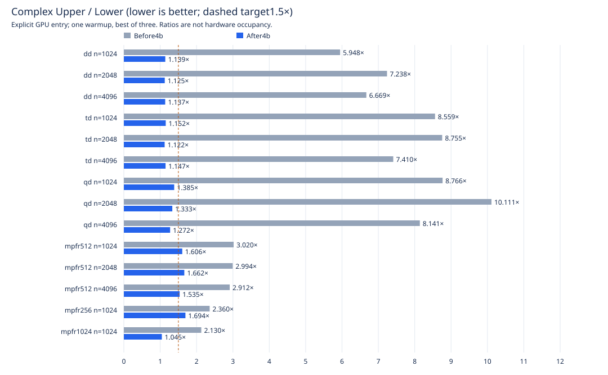

# Upper Cholesky — factorization goal10, item4b

November7,2026; A10080GB PCIe. Baseline `7e0b1f55c`; candidate is the commit containing this report. Upper stays left-looking and bit-identical under the exact validation corpus. Item5 precedes this work.

## Results and remaining exceptions

Native complex dd/td/qd meets the **Upper ≤1.5× Lower** target at all three required sizes; MPFR1024 at1024 also meets it. **MPFR256 and512 still miss the target** at the measured points below. This is an explicit measured shortfall, not a claim of parity. Final profiles document the remaining costs.

| Type | n | Upper before s | Upper after s | Speedup | After Upper/Lower |
|---|---:|---:|---:|---:|---:|
| dd | 1024 | 0.380968 | 0.0707352 | 5.386× | 1.139× |
| dd | 2048 | 1.43905 | 0.219105 | 6.568× | 1.125× |
| dd | 4096 | 5.74989 | 0.98839 | 5.817× | 1.137× |
| td | 1024 | 0.902247 | 0.122194 | 7.384× | 1.152× |
| td | 2048 | 3.43252 | 0.447626 | 7.668× | 1.122× |
| td | 4096 | 13.73 | 2.14172 | 6.411× | 1.147× |
| qd | 1024 | 1.78835 | 0.257058 | 6.957× | 1.385× |
| qd | 2048 | 6.80048 | 0.893504 | 7.611× | 1.333× |
| qd | 4096 | 27.3721 | 4.29153 | 6.378× | 1.272× |
| mpfr512 | 1024 | 4.73495 | 2.52111 | 1.878× | 1.606× |
| mpfr512 | 2048 | 19.5525 | 11.259 | 1.737× | 1.662× |
| mpfr512 | 4096 | 113.793 | 59.6314 | 1.908× | 1.535× |
| mpfr256 | 1024 | 1.9996 | 1.33638 | 1.496× | 1.694× |
| mpfr1024 | 1024 | 12.7003 | 6.26372 | 2.028× | 1.045× |

[Full tables](tables.md) include real/complex LU, Lower and Upper, all84 paired cases, repeated1024 medians, runtime200, both roofline models and the repaired historical Lower table. See also [real Upper speedups](upper-speedup-real.svg). Whole-entry seconds are not resident-kernel seconds.

## Controls: variability is not hidden

The host is shared. Empty GPU receipts establish the stated GPU-isolation protocol, not an idle CPU host. At06:43 the observed host load averages were41.21/41.16/40.84; this is **not** a reconstructed load history for earlier runs ([observation](host-load-note.txt)). Whole-entry measurements include CPU setup/transfers. These samples do **not** prove all controls regression-free.

| Sample set | Lowest control speedup | Highest control speedup |
|---|---|---|
| Required matrix | 0.863× (qd real getrf, n1024) | 1.119× (dd real potrf-L, n1024) |
| Repeated medians | 0.913× (qd complex potrf-L, n1024) | 1.112× (qd real getrf, n1024) |
| Runtime200 | 1.002× (mpfr200 real potrf-L, n512) | 1.012× (mpfr200 complex getrf, n512) |

Repeated MPFR512 complex LU1024: 5.83→6.07744s (+4.24%). The qd-real LU control changes direction between the primary and repeated samples; no post-hoc normalization or favorable-sample replacement is applied.

The superseded serialized schedule also retained its repeated MPFR512 complex LU1024 result5.78305→5.98700s (+3.53%). Separately, the original cumulative **~7.1% MPFR512 complex LU2048 regression predates item5** and remains an unresolved historical performance caveat. Neither is erased by this supplement.

## Final profiles and remaining bottlenecks

Four calls/profile; percentages below are **summed kernel-duration shares**, not entry-wall percentages. Concurrent durations overlap. [Raw groups](profiles-after.csv), [timeline unions](profiles-after-timeline.csv) and [selected sm80 resources](resources-selected.csv) supply the detailed evidence.

| Final case | GEMM % | HERK/SYRK % | TRSM % | Leaves % | Sum / union |
|---|---:|---:|---:|---:|---:|
| dd-complex-1024 | 27.08 | 21.58 | 32.16 | 19.17 | 1.269 |
| dd-complex-4096 | 56.05 | 19.84 | 13.18 | 10.93 | 1.499 |
| mpfr-complex-1024 | 44.55 | 17.06 | 35.42 | 2.97 | 1.220 |
| mpfr-complex-4096 | 75.62 | 8.58 | 15.32 | 0.48 | 1.185 |
| mpfr-real-1024 | 21.82 | 18.35 | 42.82 | 17.01 | 1.326 |
| mpfr-real-4096 | 55.28 | 13.54 | 24.31 | 6.87 | 1.331 |
| mpfr1024-complex-1024 | 48.44 | 16.23 | 29.51 | 5.82 | 1.228 |
| mpfr200-complex-512 | 37.18 | 33.06 | 25.92 | 3.83 | 1.172 |
| mpfr200-real-512 | 22.30 | 25.79 | 37.89 | 14.02 | 1.000 |
| mpfr256-complex-1024 | 34.51 | 16.18 | 46.59 | 2.71 | 1.184 |
| qd-complex-1024 | 31.75 | 24.78 | 25.76 | 17.71 | 1.340 |
| qd-complex-4096 | 61.84 | 17.91 | 11.63 | 8.62 | 1.372 |
| td-complex-1024 | 27.47 | 21.18 | 30.83 | 20.52 | 1.327 |
| td-complex-4096 | 58.18 | 16.53 | 13.22 | 12.07 | 1.445 |

Before4b, dd complex4096 spent87.84% of summed kernel duration in HERK; MPFR512 complex4096 spent70.75% in GEMM,15.31% in HERK and13.16% in TRSM. The new tiles substantially reduce the old single-job/small-grid update costs; narrow geometry, solves and software-arithmetic costs remain.

The initial candidate had MPFR-complex sum/union1.0: safe arena joins serialized its streams. The final host schedule queues both independent GEMMs before either solve; interval overlap is now observable without changing arena bounds. The [superseded timeline](profiles-serialized-schedule-timeline.csv) is retained, not used as final timing data. Increased summed duration during overlap is not necessarily an increased wall time.

At low/medium fixed complex precision, bounded transpose TRSM remains substantial: grid1..64 blocks cannot expose108 independent blocks, and the source retains actual MPC division with its existing arena/call-stack constraints. At4096 the resident C/N GEMM remains the largest summed-duration component. Fixed512/1024 update kernels use254 registers/thread and8×8 blocks; their static resource/launch geometry is recorded, not converted into a measured occupancy claim. Generic runtime updates retain their conservative bounded jobs.

Further improvement needs care around narrow panel work, ordered arithmetic, division and arena-safe scheduling; this report does not infer a particular stall mechanism without counters. **ncu: ERR_NVGPUCTRPERM.** No occupancy/stall counters were obtained.

## Kernel/model evidence

[Public-kernel comparisons](roofline-kernels-comparison.csv), [resident complex comparisons](roofline-resident-comparison.csv) and [item5 model recomputation](roofline-item5-comparison.csv) provide seconds and both percentages. Revised/full-width and historical/double-derived peaks change only the denominator. Percentages are model bounds, not occupancy. Public MPFR Cgemm is an unchanged control; changed resident updates have their own measurements. Runtime200 has no invented arithmetic peak.

## Validation and reproducibility

Both builds pass. Stable dynamic exports are unchanged (dd1683,td1700,qd1691,MPFR3346), and54 discovered archives have unique symbols; this includes installed/legacy copies, not54 new builds. The campaign covers60 BF and40 MPFR consumers,26 autotools hosts, six public-BLAS suites,22 extended edge suites,10 large factor suites and mandatory BF/MPFR-real memchecks. The final scheduling-only change reran the affected MPFR corpus; unchanged tests and identical BF libraries are explicitly identified in [validation](validation/README.md).

Supplementary renamed-reference HERK and actual-division TRSM checks, eight strict resident boundary dump pairs, actual component-precision assertions and the reproducer are supplied. Existing public fixed-complex zero-sign exception counts were unchanged; factors/resident boundaries have no such allowance.

**Full MPFR complex memcheck remains UNVERIFIED under the approved exception.** Passing the two value-only update helper memchecks does not lift it. No external MPC, stack policy, reference bodies, CPU/default/fast paths or public ABI was changed.

See [methodology and rejected probes](METHODOLOGY.md), [validation runner](validation/run.py), [provenance/receipts](provenance.json), and [all tables](tables.md). The repaired historical Lower table for `6067ce60d` is included; original items1–5 fields remain unchanged. Historical representative results still include MPFR512 Lower2048 75.7610→6.33348s and MPFR1024 GEMM NN1024 2.210118→1.688066s; those are not new item4b measurements.
