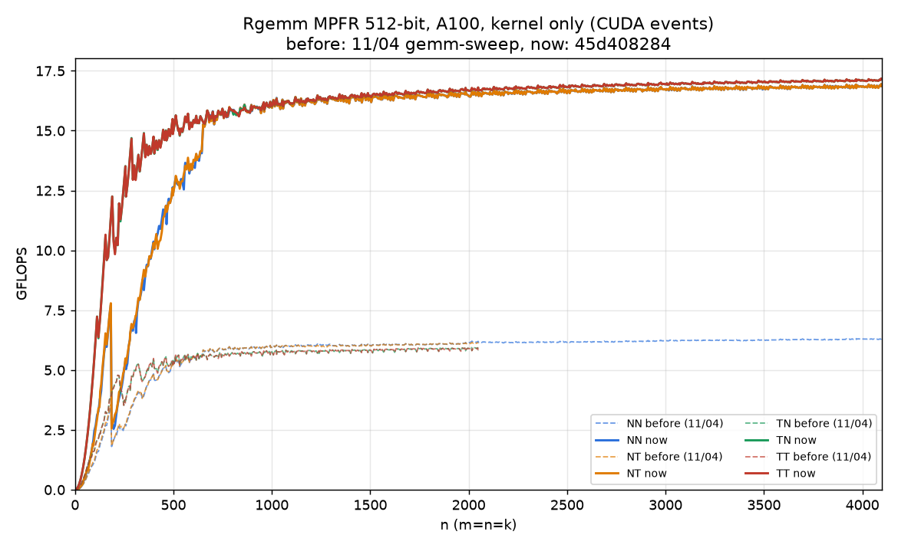
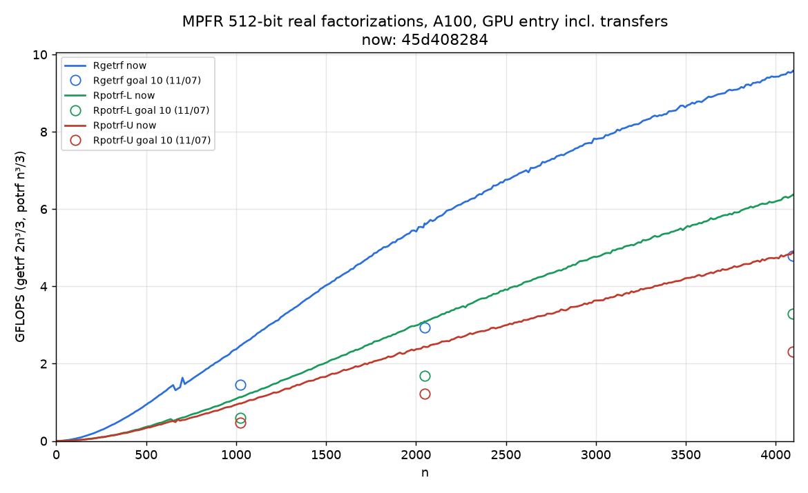

# MPFR 512 re-measurement after factorization goals 11–13 (2026-11-16)

A100 80GB PCIe + Threadripper 3970X, commit in `commit.txt`, GPU otherwise idle
(`gpu-processes-at-*.txt`, `run.log`). Reproduce with `./run.sh`
(`FACTOR_ONLY=1` skips the GEMM sweeps).

## Rgemm NN/NT/TN/TT (kernel only, CUDA events)

Same method as `../gemm-sweep` (2026-11-04); all four forms now go to n=4096.

| n | NN | NT | TN | TT |
|---|---|---|---|---|
| 1024 | 6.04 → 16.37 | 6.04 → 16.35 | 5.65 → 16.32 | 5.65 → 16.32 |
| 2048 | 6.20 → 16.67 | 6.15 → 16.67 | 5.80 → 16.80 | 5.80 → 16.81 |
| 4096 | 6.31 → 16.94 | — → 16.94 | — → 17.16 | — → 17.17 |

## Rgetrf / Rpotrf L / Rpotrf U (GPU entry, whole call incl. packing and transfers)

`Rfactor.mpfr_cuda_total --entry --warmup 1 --max 4096` with
`MPLAPACK_MPFR_LAPACK_CUDA_MIN=1` so every n runs on the GPU. Circles: goal 10
(2026-11-07, `../gpu-opt/upper/matrix.csv`, after_s).

| n | Rgetrf | Rpotrf L | Rpotrf U |
|---|---|---|---|
| 1024 | 1.46 → 2.47 | 0.60 → 1.14 | 0.47 → 0.97 |
| 2048 | 2.94 → 5.63 | 1.69 → 3.10 | 1.22 → 2.44 |
| 4096 | 4.79 → 9.58 | 3.29 → 6.37 | 2.31 → 4.87 |

GFLOPS (getrf 2n³/3, potrf n³/3). The first factor attempt in `run.log` was
rejected because the MIN variable was not yet set; it was rerun.
