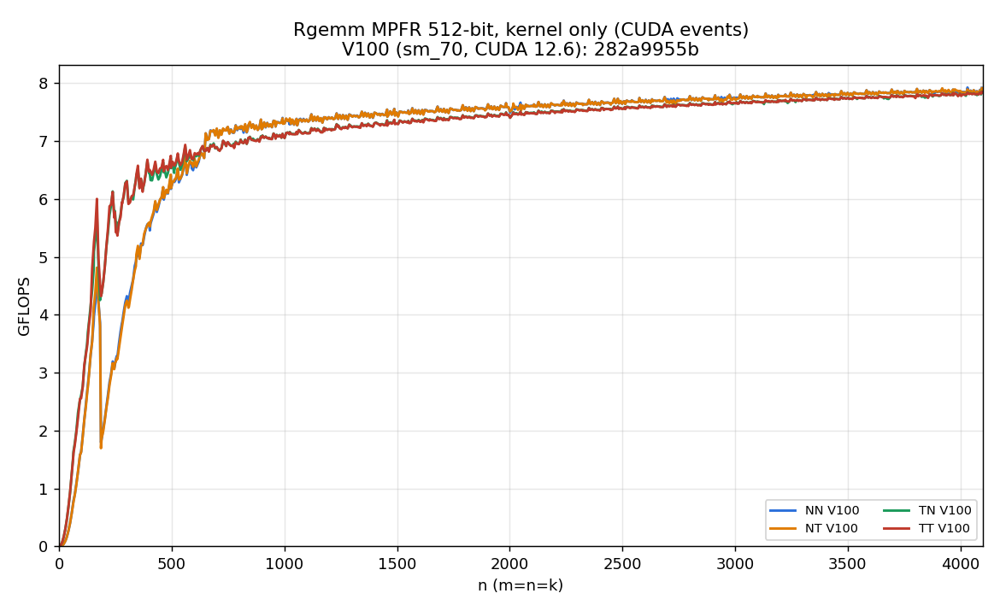
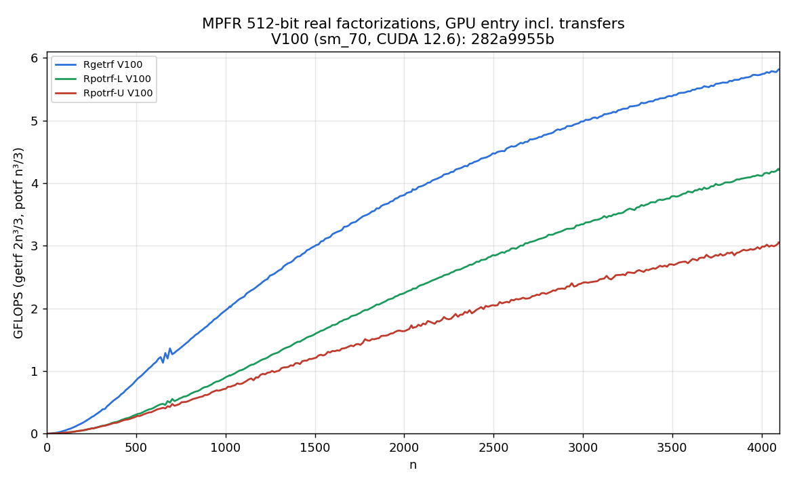

# MPFR 512 Rgemm and Rgetrf/Rpotrf on the V100 (2026-11-20)

Tesla V100-PCIE-32GB (sm_70, 1380 MHz, driver 580.196.07) + Xeon Gold 5122,
CUDA 12.6 from NVIDIA HPC SDK 24.11, GCC 11.  Commit and local diff in
`commit.txt` (master 282a9955b plus the CUPTI record fix of
`benchmark/Rkernel_bench.cpp` and the GCC 11 target_clones fix of
`mpblas/optimized/common/Rgemm_simd_common.h`, committed with this
directory).  GPU otherwise idle (`gpu-processes-at-*.txt`, `run.log`).
Reproduce with `./run.sh` (`GEMM_ONLY=1` or `FACTOR_ONLY=1` runs one half).

## Build on this machine

The V100 needs sm_70 instead of the sm_80/sm_90 the build assumes, and the
HPC SDK keeps cuBLAS and CUPTI outside the CUDA directory, so make was given:

    ML=/opt/nvidia/hpc_sdk/Linux_x86_64/24.11/math_libs/12.6/targets/x86_64-linux
    CU=/opt/nvidia/hpc_sdk/Linux_x86_64/24.11/cuda/12.6
    CP=$CU/extras/CUPTI
    CL="-L$CU/lib64 -L$CP/lib64 -L$ML/lib -Wl,-rpath,$ML/lib -Wl,-rpath,$CU/lib64 -Wl,-rpath,$CP/lib64"
    ./configure ... --enable-mpfr-cuda=yes --with-mpfr-cuda-arch=70 --with-cudatoolkithome=$CU
    make CPPFLAGS="-I$CP/include -I$ML/include" CUDA_CFLAGS="-I$CU/include -I$ML/include" \
         CUDA_LIBS="$CL" CUDA_LDFLAGS="$CL" \
         LDFLAGS="-L$ML/lib -Wl,-rpath,$ML/lib -Wl,-rpath,$CU/lib64 -Wl,-rpath,$CP/lib64" \
         AMPERE_FLAGS="-gencode arch=compute_70,code=sm_70 -m64 -O3" HOPPER_FLAGS="" \
         KERNEL_BENCH_CUDA_ARCH_FLAGS="-gencode arch=compute_70,code=sm_70"

`-I$CP/include` matters: /usr/include has the CUPTI of CUDA 11.5 (API 16,
no CUpti_ActivityKernel9).  The bundled mpc_cuda builds and passes its tests
with CUDA 12.6 for sm_70.

## Rgemm NN/NT/TN/TT (kernel only, CUDA events)

`benchmark/run_gemm_sweep.sh`: n = multiples of 7 and 31 and powers of 2 up
to 4096, best of 3 after 1 warmup for n <= 2000, one run above.  About 82 min
per form.

GFLOPS:

| n | NN | NT | TN | TT |
|---|---|---|---|---|
| 512 | 6.29 | 6.34 | 6.50 | 6.58 |
| 1024 | 7.36 | 7.39 | 7.16 | 7.15 |
| 2048 | 7.67 | 7.63 | 7.51 | 7.51 |
| 4096 | 7.92 | 7.92 | 7.85 | 7.85 |

The four forms are within 1% of each other at large n.

## Rgetrf / Rpotrf L / Rpotrf U (GPU entry, whole call incl. packing and transfers)

`Rfactor.mpfr_cuda_total --entry --warmup 1 --max 4096` with
`MPLAPACK_MPFR_LAPACK_CUDA_MIN=1` so every n runs on the GPU; n = powers of
2 and multiples of 13 up to 4096. Best of 3 after one warm-up for n <= 2000,
one run above. 36, 30 and 38 min.

GFLOPS (getrf 2n³/3, potrf n³/3):

| n | Rgetrf | Rpotrf L | Rpotrf U |
|---|---|---|---|
| 512 | 0.89 | 0.32 | 0.28 |
| 1024 | 2.03 | 0.93 | 0.75 |
| 2048 | 3.91 | 2.32 | 1.69 |
| 4096 | 5.82 | 4.21 | 3.05 |

The parts outside the GEMM kernel (panels, packing, transfers, and CPU
work) were not timed separately.

Plots: `plot_gemm.py`, `plot_factor.py` (matplotlib).
